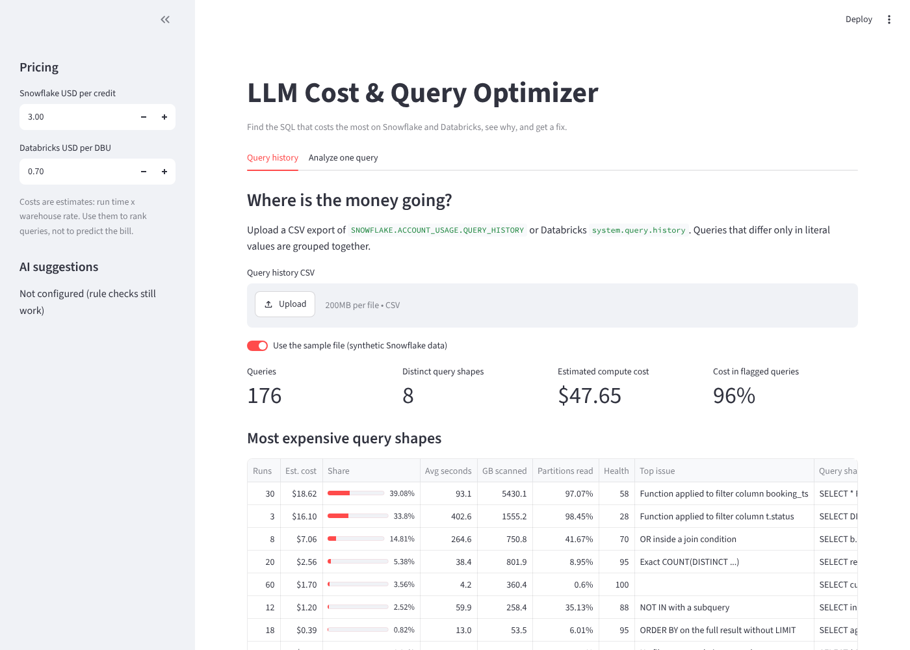

# LLM Cost & Query Optimizer

A Streamlit app that finds the SQL costing the most on **Snowflake** and **Databricks**, explains why it is expensive, and suggests a fix. A rule engine checks each query for known anti-patterns, query history is grouped and ranked by estimated compute cost, and an optional LLM (Groq) proposes an explained rewrite.



## What it does

**Query history view.** Upload a CSV export of `SNOWFLAKE.ACCOUNT_USAGE.QUERY_HISTORY` or Databricks `system.query.history`. The app:

- groups queries that differ only in literal values (`WHERE id = 5` and `WHERE id = 9` are one query shape),
- estimates compute cost per run from run time and warehouse size,
- ranks query shapes by total cost and shows each one's share, run count, data scanned and partition pruning,
- runs the rule checks on each shape and gives it a health score from 0 to 100.

**Single query view.** Paste one query, pick the platform, and see the issues and fixes before you run it.

**AI rewrite (optional).** With a Groq API key, the app sends the query, the issues found and the run metrics to an LLM and shows a rewritten query with an explanation of each change and things to check before using it.

## Rules

| Rule | Severity | Why it costs more |
|---|---|---|
| No filter on the main table | High | Scans and returns the whole table |
| Function on a filter column | High | `TO_DATE(ts) = ...` blocks partition pruning and data skipping |
| Join without a condition | High | Every row is combined with every other row |
| OR inside a join condition | High | Forces a nested loop join instead of a hash join |
| SELECT * | Medium | Reads every column of columnar storage |
| LIKE starting with % | Medium | Cannot use clustering or search optimization |
| NOT IN with a subquery | Medium | Wrong results when the subquery has a NULL; often slower than an anti join |
| DISTINCT after a join | Medium | Usually hides a bad join key and adds a large shuffle |
| Subquery in the SELECT list | Medium | Can run once per output row |
| UNION instead of UNION ALL | Low | Extra sort or hash to remove duplicates |
| ORDER BY without LIMIT | Low | Sorts the whole result |
| Exact COUNT(DISTINCT) | Low | `APPROX_COUNT_DISTINCT` is much cheaper if an estimate is fine |

Queries are parsed into a syntax tree with [sqlglot](https://github.com/tobymao/sqlglot) in the Snowflake or Databricks dialect, so the checks look at real query structure, not text patterns. Nothing is ever executed.

## How cost is estimated

```
Snowflake:   run hours x credits per hour for the warehouse size x USD per credit
Databricks:  run hours x DBUs per hour for the warehouse size x USD per DBU
```

Prices per credit and per DBU can be changed in the sidebar. Warehouses run several queries at the same time, so the total is an upper bound on the real bill. The numbers are for ranking queries, not for forecasting invoices.

## Get your query history

Snowflake:

```sql
SELECT query_id, query_text, user_name, warehouse_name, warehouse_size, start_time,
       total_elapsed_time, bytes_scanned, partitions_scanned, partitions_total
FROM snowflake.account_usage.query_history
WHERE start_time >= DATEADD(day, -30, CURRENT_TIMESTAMP())
  AND warehouse_size IS NOT NULL
  AND execution_status = 'SUCCESS';
```

Databricks (`system.query.history` has no warehouse size, so this joins each warehouse's current size from `system.compute.warehouses`):

```sql
WITH sizes AS (
  SELECT warehouse_id, warehouse_size
  FROM system.compute.warehouses
  QUALIFY ROW_NUMBER() OVER (PARTITION BY warehouse_id ORDER BY change_time DESC) = 1
)
SELECT q.statement_id, q.statement_text, q.executed_by, q.compute.warehouse_id AS warehouse_id,
       s.warehouse_size, q.start_time, q.total_duration_ms, q.read_bytes, q.read_files, q.pruned_files
FROM system.query.history q
LEFT JOIN sizes s ON s.warehouse_id = q.compute.warehouse_id
WHERE q.start_time >= current_date() - INTERVAL 30 DAYS
  AND q.execution_status = 'FINISHED';
```

If a warehouse was resized during the period, its older runs are priced at the current size. If the export has no `warehouse_size` column (or a blank one), the app lists those warehouses in the sidebar so you can pick each size.

Runs whose warehouse size has no known rate are counted as $0, and the app shows a warning with how many runs that affects.

Download the result as CSV and upload it in the app. The repo also includes a synthetic sample file, `data/sample_snowflake_query_history.csv`, so you can try the app without an account.

## Run it

```bash
python -m venv .venv
source .venv/bin/activate          # Windows: .venv\Scripts\activate
pip install -r requirements.txt
streamlit run app.py
```

To turn on AI rewrites, get a free key from [Groq](https://console.groq.com) and either set it as an environment variable or put it in Streamlit secrets:

```bash
export GROQ_API_KEY="your-key"     # Windows PowerShell: $env:GROQ_API_KEY="your-key"
# or
cp .streamlit/secrets.toml.example .streamlit/secrets.toml   # then edit the key
```

`secrets.toml` is in `.gitignore`. The model can be changed with the `GROQ_MODEL` environment variable.

When the AI returns a rewrite, the app parses it and runs the same rules on it. It shows the health score before and after, which issues were fixed, any that remain or are new, and a warning if the output columns changed. A rewrite that does not parse is flagged as unusable. These checks look at structure only; compare results on a sample before replacing the original query.

## Run the tests

```bash
pip install -r requirements-dev.txt
pytest
```

The tests cover every rule, query fingerprinting, cost calculation for both platforms, warehouse size handling, export detection, the AI rewrite check, and the LLM request and response handling (with the API mocked). GitHub Actions runs them on every push and pull request.

## Project structure

```
app.py                          Streamlit UI
src/query_optimizer/
    rules.py                    sqlglot-based anti-pattern rules, fingerprinting, health score
    costs.py                    history loaders for Snowflake and Databricks, cost estimates, grouping
    llm.py                      Groq client, prompt and response parsing
data/sample_snowflake_query_history.csv   synthetic demo data
scripts/make_sample_history.py            generates the demo data
tests/                          pytest suite
```

## Tech stack

Python, Streamlit, sqlglot, pandas, Groq API (Llama 3.3), pytest.

## Author

Rakshit Bahadur, Senior Data Engineer. [GitHub](https://github.com/rakshit-bahadur) · [LinkedIn](https://www.linkedin.com/in/rakshit-bahadur) · [Website](https://rakshit-bahadur.github.io)
